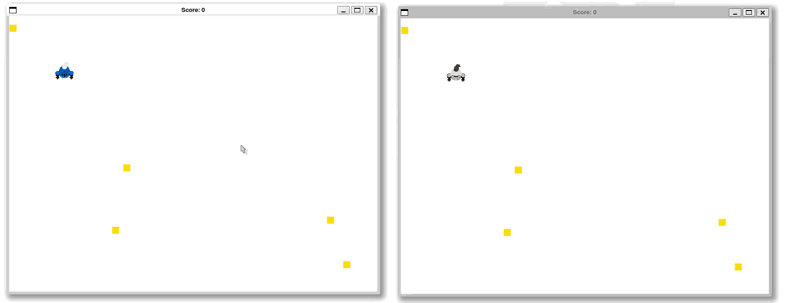
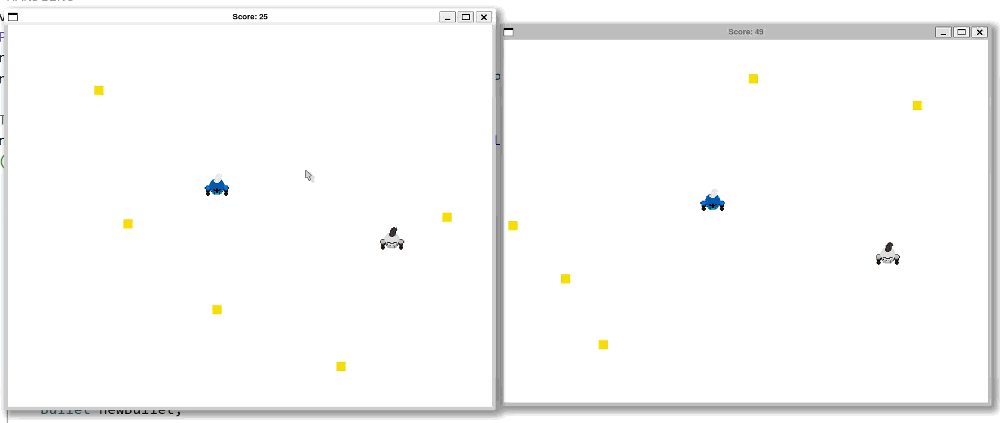
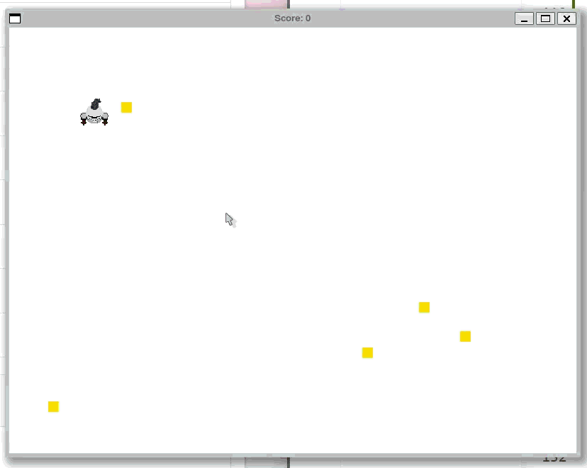
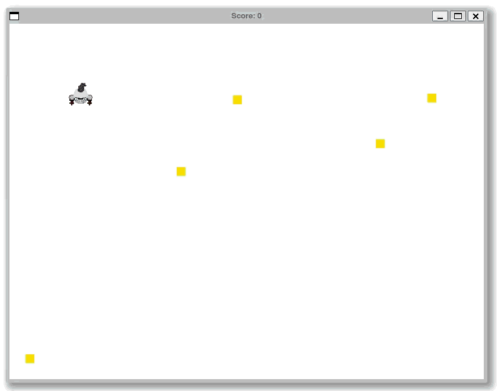
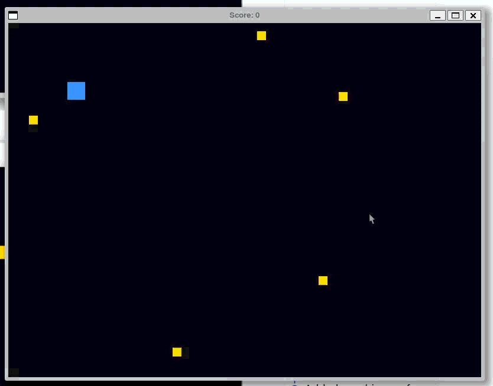
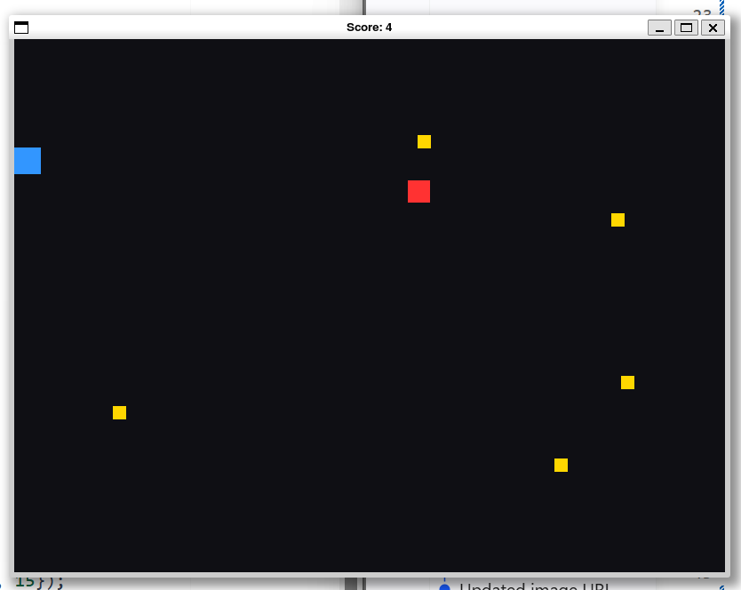
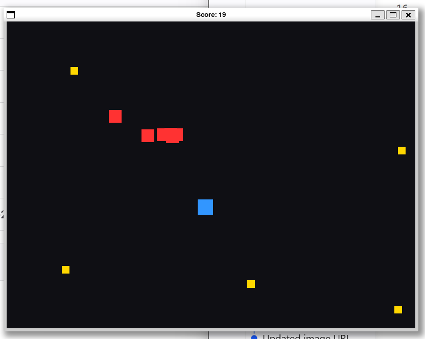

# CPP-CMake 

## Kevin Bell GUI Game

<!-- 

 

 -->

kevinBell@Linux.com

[kevinBell.dev](https://kevinBell.dev/)

## Purpose
This is a starter project used for learning the C or C++ languages. It is only intended to provide you the resources to practice your coding skills. It is not intended to provide a repository for long-term storage. You will not be able to push to the main branch, and all other branches will be deleted on a regular basis if they have not been used in a while.

## Development environment
This project is configured to use a dev container for its development. It also includes VS Code configuration files to allow the debugger to run inside VS Code. This repository is configured to utilize CMake to compile the code. 

## Debugging
The .vscode directory provides the configuration files for debugging. Every project has a default setting that can be run by pressing F5. For projects that have more than one configuration, you can select the option you want from the "Run and Debug" section in the left sidebar of VS Code, then picking your desired option from the dropdown menu at the top of the screen.
