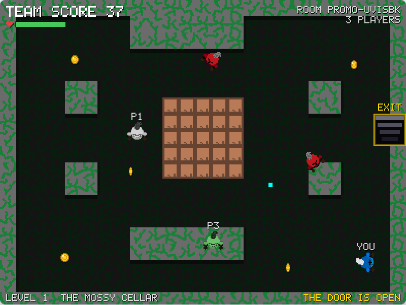
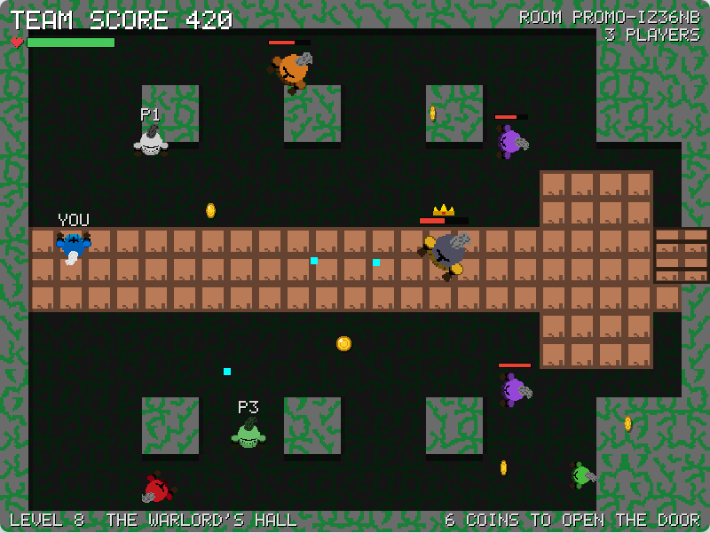

# Knight Survival

A small multiplayer survival shooter written in C++ with SDL2. Play it in your browser with
friends: no sign-up, no download, no game server.

### ▶ [Play now: bell-kevin.github.io/knight-survival](https://bell-kevin.github.io/knight-survival/)



Collect the gold coins, shoot the bad knights, and stay alive. Every coin is a point for the
whole team, and every 5 coins another bad guy shows up. Collect enough coins and the level's
door opens: walk through it and the whole team goes on to the next level. Every touch from a bad
guy takes some of your health, and when it's gone you're out until you jump back in. You get all
your health back when you do, and at the start of every level. If everybody is out, the world
starts over at level 1.

There are eight levels, and after the last one the first comes round again with more bad guys.
They are maps made with the free [Tiled](https://www.mapeditor.org/) editor, and you can
[make your own](maps/README.md).

## The bad guys

| Bad guy | What it's like | Shots to beat it | A touch takes | Points |
| ------- | -------------- | :--------------: | :-----------: | -----: |
| Red knight | The original | 1 | 30 health | 10 |
| Green scout | Small and quick | 1 | 15 health | 15 |
| Purple champion | A little quicker than a red knight | 3 | 40 health | 30 |
| Bronze brute | Big and slow | 8 | 60 health | 60 |
| The warlord | Huge, crowned, and waiting in the last hall | 25 | all of it | 250 |

You have 100 health. A bad guy that touches you pushes you back, and you blink for a moment
while nothing can hurt you again. The ones that take more than one shot carry a health bar, and
flash when a bullet hits them. They are all the red knight, recolored by the game, and how strong
each kind is lives in [`src/enemies.h`](src/enemies.h).



## How to play

|         | Keyboard and mouse        | Phone or tablet                  |
| ------- | ------------------------- | -------------------------------- |
| Move    | `WASD` or the arrow keys  | Left thumb stick (or drag your knight) |
| Shoot   | Left click (aims at the pointer) | Right thumb stick: push it to aim and keep firing, tap it to hit the nearest bad guy (or tap the field) |
| Respawn | Any key                   | Tap                              |

**On a phone or tablet** the game gets the whole screen, with a thumb stick on each side; hold
it sideways for the biggest view. The menu button has the invite link and the way back to the
lobby. On Android, pressing Play goes full screen. iPhones don't let web pages go full screen,
in any browser, so there the game asks you to swipe up when you hold the phone sideways: the
browser's bars slide out of the way. For a full-screen game every time, open it in Safari and add
it to your home screen (Share, then Add to Home Screen).

**Playing together:** press **Play now** to join the public lobby, or **Create private room** and
send the invite link to your friends. Up to 8 knights can play in a room. Nobody needs an
account, and nothing is installed.

## How it works

GitHub Pages can only host files, so there is no game server. Instead:

1. The C++ game is compiled to WebAssembly with [Emscripten](https://emscripten.org/).
2. Browsers in the same room find each other through public [Nostr](https://nostr.com/) relays
   (an open, decentralized protocol), then connect directly to each other with WebRTC.
3. One player's browser, the **host**, runs the same world simulation as the native server
   ([`src/world.cpp`](src/world.cpp)). Everyone else sends the host their position and shots,
   and the host sends the whole world back 30 times a second, using the same text protocol as
   the original TCP server.
4. When the host leaves, or its tab is hidden and the browser pauses it, another player takes
   over from the last snapshot, so the game and the score carry on. A host that comes back
   just joins in as a guest.

All the game logic, including who hosts and how worlds merge, is C++
([`src/session_web.cpp`](src/session_web.cpp)). The only JavaScript is the page itself and
[`web/net.js`](web/net.js), which just passes text messages between browsers using
[Trystero](https://github.com/dmotz/trystero).

**Privacy:** no cookies, no analytics, no accounts, nothing stored. Like in any peer-to-peer
game, the players in your room (and the relays that introduce you) can see your IP address.

## Building it yourself

You need CMake and a C++20 compiler.

**Web version** (what the site runs), with [Emscripten](https://emscripten.org/docs/getting_started/downloads.html):

```sh
emcmake cmake -B build-web -DCMAKE_BUILD_TYPE=Release
cmake --build build-web
python3 -m http.server -d build-web/site 8080   # then open http://localhost:8080
```

**Native version** (Linux, macOS, or WSL on Windows), with SDL2 (for example `sudo apt install libsdl2-dev`):

```sh
cmake -B build
cmake --build build
./build/knight-survival              # plays solo when no server answers
```

To play on a local network, start the server on one computer and point every game at it:

```sh
./build/knight-server                # listens on TCP port 9000
./build/knight-survival 192.168.1.20 # the server's IP address
```

Run the tests with `ctest --test-dir build`. Every push to `main` is built and tested by
[GitHub Actions](.github/workflows/pages.yml), which also publishes the web version.
[`tests/browser`](tests/browser) has tests where real browsers play the web version together.

## What's where

| Path | What it is |
| ---- | ---------- |
| [`src/main.cpp`](src/main.cpp) | The game: input, movement, drawing |
| [`src/world.cpp`](src/world.cpp) | The rules: coins, bad guys, bullets, score, doors and levels |
| [`src/enemies.h`](src/enemies.h) | The kinds of bad guys: how big, fast, tough and strong each one is |
| [`src/level.cpp`](src/level.cpp) | Reads the level maps, and finds the way around their walls |
| [`maps/`](maps/) | The levels, made with Tiled ([how to make one](maps/README.md)) |
| [`src/session_web.cpp`](src/session_web.cpp) | Online play in the browser: hosting, joining, host hand-over |
| [`src/session_native.cpp`](src/session_native.cpp), [`src/net.h`](src/net.h) | Native play: TCP client, or solo |
| [`server/server.cpp`](server/server.cpp) | LAN server for the native game |
| [`client/client.cpp`](client/client.cpp) | Terminal client for poking at the server |
| [`src/font.h`](src/font.h) | The tiny pixel font for the score and labels |
| [`web/`](web/) | The web page (and what makes it a home-screen app), the message relay script and the vendored Trystero library |
| [`assets/`](assets/) | The knight sprites (8 directions each) and the tiles the levels are made of |
| [`tests/`](tests/) | Tests for the rules and the message format, and browsers playing together |

## Free software

Knight Survival is free software: you can use, study, share and change it under the terms of
the [GNU General Public License, version 3 or later](LICENSE). That covers the code, the art and
the levels in this repository, except for the files in [`web/vendor`](web/vendor), which keep
their own MIT licenses.

Everything it is built with is free software too: SDL2 (zlib), Emscripten (MIT/NCSA),
Trystero and noble-secp256k1 (MIT), CMake (BSD), and the levels are drawn with Tiled (GPL). The page loads nothing from other websites:
everything comes from this repository, apart from the connections to other players, the Nostr
relays that introduce them, and the STUN servers that help them connect through home routers.

## History

The game started as a desktop SDL2 game with a TCP server for playing over a LAN:


## Author

Kevin Bell · kevinBell@Linux.com · [kevinBell.dev](https://kevinBell.dev/)
